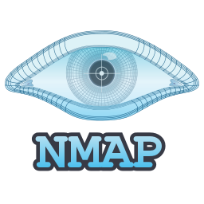

  

My field is Computer Science, with a specialization in Cybersecurity. I build and ship independent projects across computer vision, Python automation, backend systems, and embedded AI, and currently focus on AI agent architectures and Model Context Protocol (MCP) tooling for practical developer workflows.

  
  

---

## Quick Credentials

  
  
  

---

## Skills & Tools

### Languages

  &nbsp;&nbsp;
  &nbsp;&nbsp;
  &nbsp;&nbsp;
  &nbsp;&nbsp;
  &nbsp;&nbsp;
  

### AI & ML

  &nbsp;&nbsp;
  &nbsp;&nbsp;
  

### Backend

  &nbsp;&nbsp;
  

### Automation

  &nbsp;&nbsp;
  

### Embedded

  

### Cybersecurity & Pentesting

  &nbsp;&nbsp;
  &nbsp;&nbsp;
  &nbsp;&nbsp;
  &nbsp;&nbsp;
  

<strong>Also used:</strong> 
  &nbsp;
  &nbsp;
  &nbsp;
  &nbsp;
  &nbsp;
  

### Tools

  &nbsp;&nbsp;
  &nbsp;&nbsp;
  &nbsp;&nbsp;
  &nbsp;&nbsp;
  &nbsp;&nbsp;
  

---

## Work / Cybersecurity & Coding Journey

🚀 My Coding Journey

- **AI Automation Tools:** Built a layered Python suite for web scraping and multi-source processing, with a threaded Tkinter UI that stays responsive.
- **Cybersecurity & Pentesting:** Used Burp Suite, OWASP ZAP, ffuf, sqlmap, Hydra, John the Ripper, and Netcat for web application and network security testing.
- **Computer Vision Projects:** Built YOLOv8 and OpenCV detection pipelines from dataset preparation through training, validation, and automation integration; balanced accuracy with inference speed.
- **Embedded AI Projects:** Prototyped ESP32-CAM live streaming and user authentication within microcontroller memory, compute, and connectivity limits.
- **AI Agent & Developer Tooling Research:** Studied MCP architecture and multi-agent coordination for AI-assisted developer workflows.

**Education:** B.Sc. Computer Science (Cybersecurity).

**Certification:** UI/UX Design Training (100 hours), Arabian Academy in Alexandria, 2025 — Figma wireframes and prototypes, design systems, and usability evaluation.

**Languages:** Arabic (native), English (upper-intermediate, B2).

---

## GitHub Stats

  
  

---

## Connect

I am always open to connecting with people working on AI agents, computer vision, cybersecurity, and automation. Explore my pinned repositories or reach out to discuss a project.

